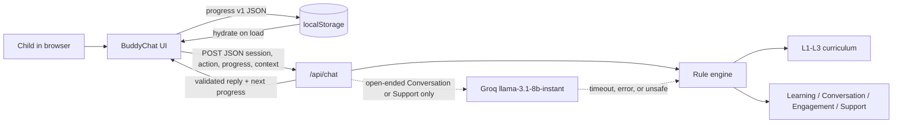
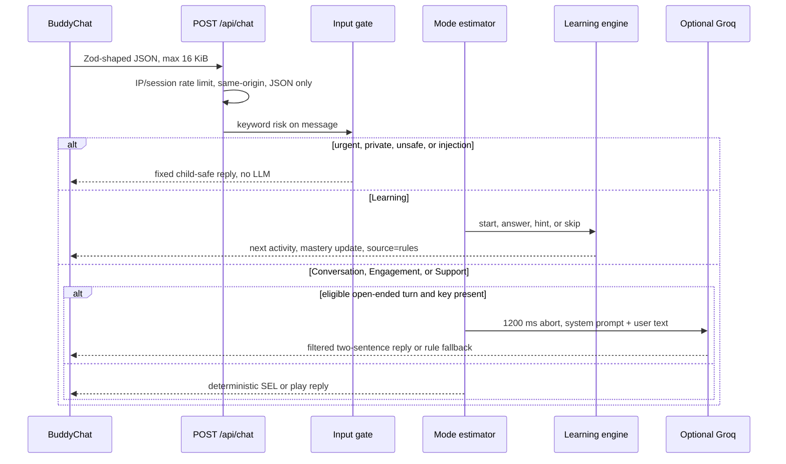
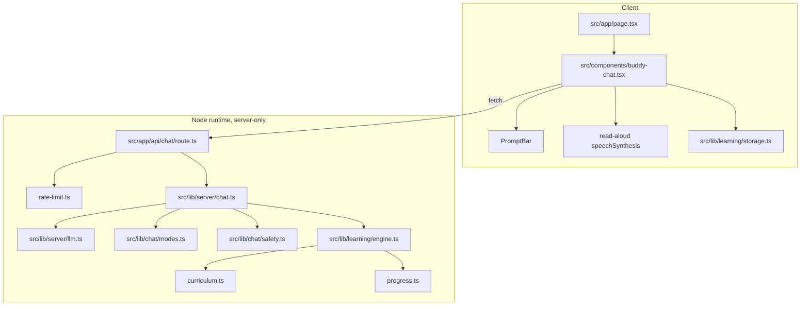

# Architecture

Little Buddy is a Next.js App Router app. The browser holds chat text in memory and skill progress in `localStorage`. One serverless route (`POST /api/chat`) owns validation, mode estimation, the learning engine, and an optional Groq call with a hard timeout.

## System context

## Request path

## Module map

## What is not in the diagram

There is no database, auth, parent dashboard, or application log of child messages. Speech is browser `speechSynthesis` only. Groq is skipped when the key is missing, the model env is unsupported, the turn is a quiz, or the input is risky.
